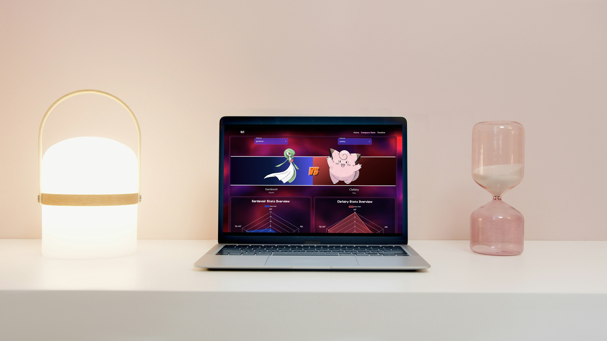
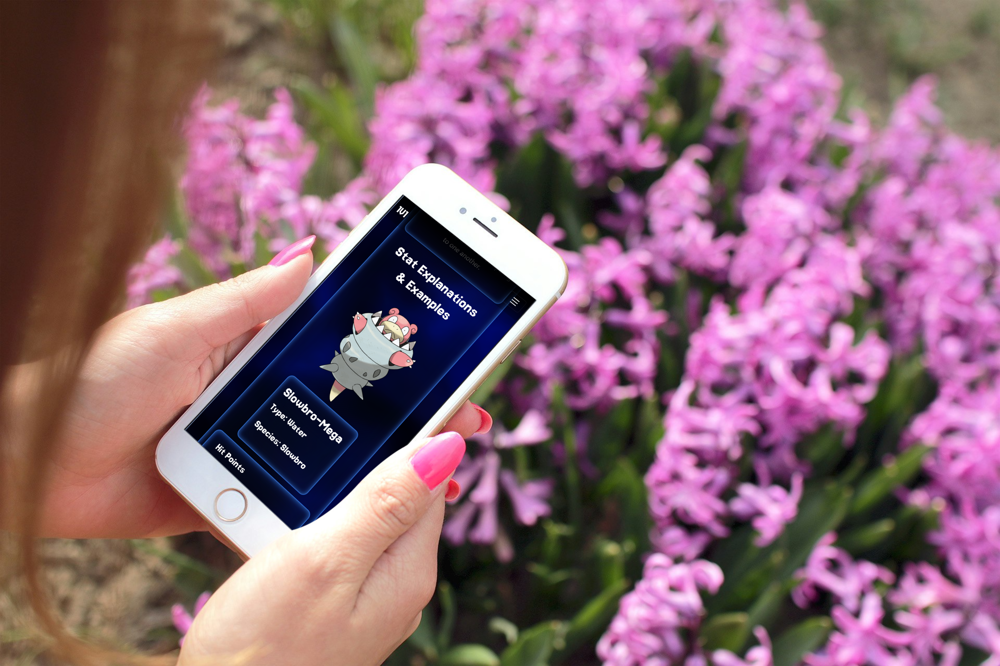

## <p align="center" style="text-decoration: none !important;padding:0;margin:0;"> <br>DV 200 Semester 1</p>
<p align="center"></p>

### <p align="center" style="text-decoration: none !important;padding:0;margin:0;">Eunice van Zyl 251023</p>

## Table of Contents

* [About 1V1](#About-1v1)
  * [Built With](#built-with)
* [Getting Started](#getting-started)
  * [How to install](#how-to-install)
  * [File Structure](#file-structure)
* [Features and Functionality](#Features)
* [Final Outcome](#final-outcome)
    * [Mockups](#mockups)
    * [Demo Video](#demo-video)

---

## About 1v1

1v1 aims to make comparing Pokémon statistics easier and more accessible for beginners by making the data clear and concise. Each Pokémon has a set of statistics that can make them better for certain tasks than others. All you have to do is pick two Pokémon and have us do the heavy lifting. You’ll be able to see a layout of how the two Pokémon's base statistics compare to each other as well as how much experience they need to level up and the amount of experience they give when defeated in battle. On the timeline you’ll be able to see how a Pokémon's stats will change as they level up. Below you’ll be able to see what the basic layout of a Pokémon's stats will look like as well as the stats we’ll be comparing to one another.

### Built With
[](https://www.javascript.com/)
[](https://nodejs.org/en)
[](https://react.dev/)
[](https://www.chartjs.org/)
[](https://getbootstrap.com/)
[](https://mui.com/material-ui/getting-started/)

## How To Install

To get started, clone the repo:
```
git clone https://github.com/NicciVanZyl/1v1.git
```

Install all the dependencies using npm:
```
npm install
```

Run the app:
```
npm start
```

### File Structure:
```text
1V1:
└── niccivanzyl-1v1/
    ├── README.md
    ├── package.json
    ├── public/
    │   ├── index.html
    │   ├── manifest.json
    │   └── robots.txt
    └── src/
        ├── App.css
        ├── App.js
        ├── App.test.js
        ├── index.css
        ├── index.js
        ├── reportWebVitals.js
        ├── setupTests.js
        ├── typePalettes.js
        ├── VantaBackground.js
        ├── components/
        │   ├── barchart.js
        │   ├── footer.js
        │   ├── linechart.js
        │   ├── navbar.js
        │   ├── piechart.js
        │   ├── radarChart.js
        │   ├── radioButtons.js
        │   ├── selectors.js
        │   ├── toggleButtons.js
        │   ├── typeTheme.js
        │   └── useTypeTheme.js
        └── pages/
            ├── comparison.js
            ├── home.js
            └── timeline.js

```
---

## Features

| Home Page | Comparison Page | Timeline Page |
| :--- | :--- | :--- |
| Random Pokemon details overview | Compare Pokemon Details | Pokemon details overview |
| Stat descriptions | Compare Pokemon base stats | Pokemon Stat growth |
| | Compare pokemon levelup experience | Pokemon maximum, minimum and expected stats |
| | Compare Pokemon total experience given when killed |  |

## Final Outcome:

### Mockups:

## Desktop
<p align="center"></p>

## Mobile
<p align="center"></p>

## Tablet
<p align="center"></p>

---

### Demo Video:
[Google Drive Link](https://drive.google.com/file/d/1jOM2qY_w2ls1gWQDtNwd1isvTd9utHzp/view?usp=sharing)

---
